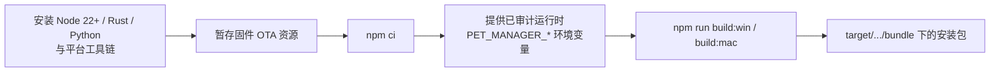

<p align="center"></p>

<h1 align="center">HachimoDock-beautiful</h1>

<p align="center">
  <a href="https://github.com/ai-maker-lab/HachimoDock"></a>
  
  
  <a href="https://github.com/laochenfei233/HachimoDock-beautiful/actions/workflows/build-installers.yml"></a>
</p>

<p align="center">HachimoDock 的非官方分支：在公开审计链路上构建 Windows / macOS 四个平台的安装包，并内置应用内更新与更新提醒。</p>

## 这不是官方版本

- 本仓库是 [HachimoDock](https://github.com/ai-maker-lab/HachimoDock) 的**个人非官方分支**，与上游作者无隶属、合作或背书关系。
- 依据上游许可证第 4、5 条，本分支明确标注为修改版本，不冒充官方发布；品牌与标识不随源码授权。
- 安装包由本仓库的 GitHub Actions 从本分支源码构建，**没有**上游的签名与公证（见「平台支持」）。
- 需要官方版本请前往 [上游 Releases](https://github.com/ai-maker-lab/HachimoDock/releases)。

## 功能

HachimoDock 本体是连接桌面小屏的宠物伴侣与 Agent 状态看板。本分支在此基础上：

- **应用内更新**：设置页「其他配置 → 应用更新」查询本仓库 Releases，显示发布说明，可直接下载安装包（带进度、支持网络镜像回退）并启动安装器；不支持应用内安装的平台引导到发布页。
- **更新提醒**：新版本发布满 12 小时后，启动客户端会弹窗展示版本与更新内容，可当场安装；同一版本只提醒一次，选「稍后提醒」后不再打扰。
- **四平台安装包**：Windows x64 / arm64 与 macOS arm64 / x64 均由流水线构建并发布到 Releases，附 `SHA256SUMS` 校验。
- **更多桌面 Agent**：在 Codex、Claude、WorkBuddy、DeepSeek Harness 之外，支持 ZCode（状态跟随 + 可见输入框语音 + 任务派发）、Prism（可见输入框语音与任务派发，会话切换经其桥接插件）、**Devin**（云端会话状态 + Windows 可见输入框语音）与 **Hermes Agent**（本地会话状态）。
- **多服务商语音**：识别与合成可分别选择豆包、通义千问、MiMo 或自定义兼容端点，支持跨服务商组合；凭据按服务商隔离，切换不串用；形象可单独指定合成服务商。
- **联网检索与天气**：实时对话可按需联网检索（含 DeepSeek 搜索源与独立 Key）；天气数据源支持和风与彩云，密钥只进系统凭据库。
- **Wi-Fi 配对**：WiFi6 板型可在同一局域网内配对，支持状态跟随、实时对话、无线组件安装与固件升级。
- **界面**：Liquid Glass 风格浅色 / 深色 / 跟随系统三态主题，橙色猫形象贯穿图标与侧边栏。

完整逐条记录见 [CHANGELOG.md](CHANGELOG.md) 与 [最新发布说明](https://github.com/laochenfei233/HachimoDock-beautiful/releases/latest)。

## 快速开始

**装起来用**：前往 [Releases](https://github.com/laochenfei233/HachimoDock-beautiful/releases/latest) 下载对应平台的安装包。**本分支新增支持 Windows arm64 与 macOS（Intel）x64**，四个平台都有对应安装包：

| 平台 | 文件 |
| --- | --- |
| Windows x64 | `HachimoDock_*_Windows-x64-setup.exe`（NSIS）或 `*_x64_en-US.msi` |
| **Windows arm64（新增）** | `HachimoDock_*_Windows-arm64-setup.exe` |
| macOS arm64 | `HachimoDock_*_macOS-arm64.dmg` |
| **macOS x64 / Intel（新增）** | `HachimoDock_*_macOS-x64.dmg` |

Windows 安装器未做 Authenticode 签名；macOS 包为 ad-hoc 签名且未公证，首次打开需在「系统设置 → 隐私与安全性」中放行。

## 本地构建

需要的语言与工具链：

| 依赖 | 版本 | 用途 |
| --- | --- | --- |
| Node.js | 22+ | 前端、打包脚本与资源准备 |
| Rust（stable） | 最新稳定版 | Tauri 桌面端（`cargo` / `rustc`） |
| Python | 3.10+ | 暂存固件 OTA 资源（`pc/scripts/stage-release-firmware.py`） |
| Windows | MSVC C++ Build Tools + WebView2 | Windows 目标的本机编译 |
| macOS | Xcode Command Line Tools | macOS 目标的编译与 DMG 打包 |



```sh
# 从仓库根目录
python pc/scripts/stage-release-firmware.py      # 暂存并校验四份 OTA 固件
cd pc
npm ci
npm run build:win     # Windows x64：NSIS + MSI
npm run build:mac     # macOS 本机架构：app + DMG
```

构建非本机架构时，除安装 Rust target 外，资源准备也要按目标架构执行（`PET_MANAGER_TARGET_ARCH`）：

```sh
# Windows arm64（需 arm64 的 MSVC 工具链与 arm64 运行时输入）
rustup target add aarch64-pc-windows-msvc
PET_MANAGER_TARGET_ARCH=arm64 npm run prepare:desktop
npx tauri build --target aarch64-pc-windows-msvc --bundles nsis --ci

# 在 Apple silicon 上构建 macOS x64（PowerShell 用 $env:NAME="value" 设置变量）
rustup target add x86_64-apple-darwin
PET_MANAGER_TARGET_ARCH=x64 npm run prepare:desktop
npx tauri build --target x86_64-apple-darwin --bundles app,dmg --ci
```

本地构建不会自动下载运行时：打包准备要求把**已审计的 LGPL FFmpeg 与 Node** 通过 `PET_MANAGER_FFMPEG_BIN`、`PET_MANAGER_FFMPEG_README`、`PET_MANAGER_FFMPEG_LICENSE`、`PET_MANAGER_FFMPEG_SOURCE_ARCHIVE`、`PET_MANAGER_NODE_BIN`（Windows 另需 `PET_MANAGER_ZLIB_LICENSE`）指向本地文件，并用 `PET_MANAGER_TARGET_ARCH=x64|arm64` 指定目标架构；校验规则与审计表见 `pc/scripts/prepare-desktop-resources.mjs`。安装包输出在 `pc/src-tauri/target/<triple>/release/bundle/`。

不想配置本地工具链时，推送代码或手动触发仓库的 `build-installers` 工作流即可：它会完成同样的准备、构建并发布到 Releases（GitHub Actions，见上方徽章）。

## 平台支持

四个目标都经过与本地构建相同的准备与审计步骤，安装包已随 Releases 发布：

| 目标 | 说明 |
|---|---|
| Windows x64 | NSIS + MSI。运行时直接取自官方安装包内已审计副本 |
| **Windows arm64** | NSIS。FFmpeg 由 llvm-mingw 从审计源码包交叉编译（静态 CRT），Node 取官方 win-arm64 分发 |
| macOS arm64 | DMG。运行时取自官方 v0.1.245 dmg |
| **macOS x64（Intel）** | DMG。FFmpeg 在 macOS 上从审计源码包交叉编译（VideoToolbox），Node 取官方 darwin-x64 分发 |

审计门禁在源码 `pc/scripts/prepare-desktop-resources.mjs`：`windows-x64`、`windows-arm64` 固定二进制 SHA-256；`macos-x64` 因链接产物不可位级复现，改为「审计源码包 + 逐字固定的 configure 配方」评审。这是安全门禁，不是可以绕过的构建开关。

MSI 的元数据版本回退为基础版本（WiX 不接受 `-rc.N` 之类的预发布版本），安装包内应用版本仍以源码版本为准。

## 许可证

本分支沿用上游的 [HachimoDock 项目许可证 1.0](LICENSE)：源码可见但**不是** GPL、MIT 或其他标准开源许可，仅授权非商业使用；再分发必须附带许可证并保留版权声明；修改版本必须清楚标注修改事实，不得暗示官方版本。第三方组件、字体与素材继续适用其各自许可证。

## 致谢

上游项目 [ai-maker-lab/HachimoDock](https://github.com/ai-maker-lab/HachimoDock)：连接设备的宠物形象、任务气泡与语音交互体验都来自上游。本分支只做构建自动化与界面 / 集成方面的个人改动；原始上游说明见 [docs/README-upstream.md](docs/README-upstream.md)。
